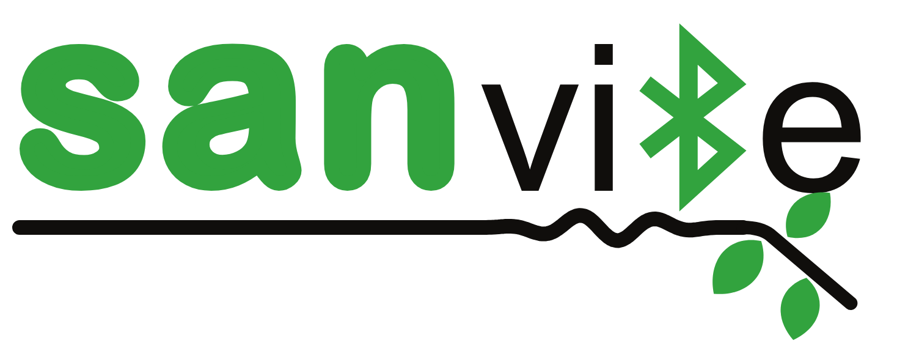

# sanvibe



> 100% vibecoded

CLI for SANlight Bluetooth dimmers on macOS, without the SANlight app. Joins the
dimmers' Bluetooth mesh via GATT proxy, with the keys from the app's mesh
export. ClojureScript on [nbb](https://github.com/babashka/nbb), Bluetooth via
[noble](https://github.com/stoprocent/noble).

## Setup

Requires macOS and Node.js 18+.

1. SANlight app: Settings > Mesh Maintenance > Export Mesh. Save it as
   `SANlightMesh.json` in the project directory, or set `SANLIGHT_MESH` to its
   path. It contains the network keys: don't commit it.
2. `npm install && npm link`
3. Allow Bluetooth access for the terminal (macOS asks on the first run).

## Usage

```text
sanvibe                         # max brightness, output, lamp clock, signal, daylight cycle
sanvibe brightness              # max brightness and output
sanvibe brightness 80           # set max brightness to 80 %, read it back
sanvibe brightness 0            # off
sanvibe cycle > my-cycle.edn    # save the daylight cycle as EDN
sanvibe cycle my-cycle.edn      # upload a daylight cycle, read it back
sanvibe help
```

- Brightness: 0 (off) or 20–100. It caps the daylight cycle running on the dimmer.
- The SANlight app must be closed: the dimmer accepts one connection.
- The first run scans for the dimmer (up to 45 s), later runs connect directly
  (about 10 s).
- Results go to stdout, progress to stderr.
- `.sanlight-state.json` holds the tool's mesh address, sequence number and the
  known dimmer. Can be deleted.

## Daylight cycles

The dimmer runs one daylight cycle, on its lamp clock: it starts at 00:00 when
the lamp gets power. `sanvibe cycle FILE` replaces it with the one from an EDN
file:

```clojure
{:name "Mid Flower"
 :id 1015331631            ; optional
 :points [["00:00" 20]     ; ["HH:MM" percent]
          ["05:00" 80]
          ["10:00" 80]
          ["12:00" 20]
          ["12:01" 0]
          ["24:00" 0]]}
```

- The dimmer interpolates linearly between the points. The max brightness caps
  the result.
- 2 to 16 points, from 00:00 to 24:00 in order, 0–100 %. A name of at most
  29 bytes. The dimmer refuses some invalid cycles but runs others, so sanvibe
  does some checks.
- Without `:id`, sanvibe derives one from the name. The app gives its cycles
  an ID; `sanvibe cycle` keeps it.
- sanvibe checks the file before connecting, and reads the cycle back after
  the upload.
- [cycles/mid-flower.edn](cycles/mid-flower.edn) is an example.

## Code

| File | |
| --- | --- |
| `bin/sanvibe.mjs` | entry point, loads the ClojureScript with nbb |
| `src/sanvibe/cli.cljs` | commands ([babashka.cli](https://github.com/babashka/cli), built into nbb), output |
| `src/sanvibe/dimmer.cljs` | SANlight vendor messages |
| `src/sanvibe/cycle.cljs` | daylight cycle EDN files |
| `src/sanvibe/proxy.cljs` | GATT proxy connection, sending and receiving |
| `src/sanvibe/config.cljs` | mesh export, persisted state |
| `src/sanvibe/mesh.cljs` | Bluetooth Mesh crypto, network and transport layer, proxy PDUs |
| `src/sanvibe/log.cljs` | progress output |
| `test/sanvibe/` | tests: mesh crypto against the spec's sample data, cycle files |

`npm test` runs the tests, `npm run lint` lints with
[clj-kondo](https://github.com/clj-kondo/clj-kondo). CI runs both on every push
and pull request, and checks that the CLI starts on macOS.

Protocol: [docs/PROTOCOL.md](docs/PROTOCOL.md)
